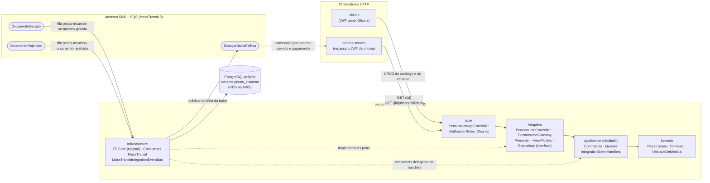
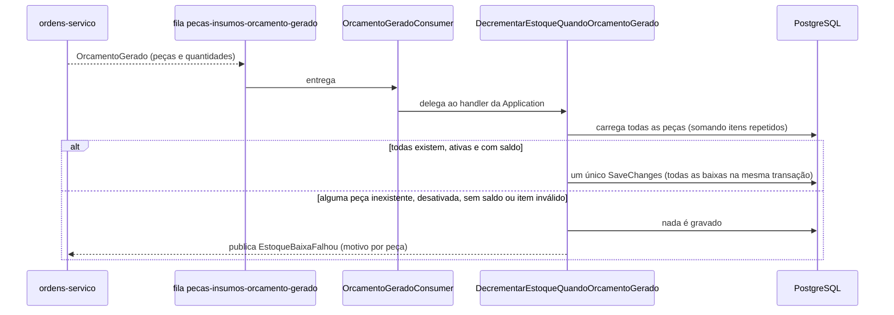

# oficina-mecanica-pecas-insumos

Microsserviço **PecasInsumos** do sistema de oficina mecânica (Tech Challenge FIAP/SOAT — Fase 4):
catálogo e **estoque** de peças e insumos. Tem banco **PostgreSQL próprio**, expõe a API REST do
catálogo/estoque e participa da **Saga coreografada** da ordem de serviço (OS): baixa o estoque quando
um orçamento é gerado, estorna quando ele é rejeitado e avisa quando a baixa não é possível.
Foi extraído do módulo `PecasInsumos` do monólito original (`oficina-mecanica-app`) e mantém a Clean
Architecture (`Domain` → `Application` → `Adapters` → `Infrastructure`/`Web`; host em `src/Bootstrap/Api`).

## Sumário

- [Responsabilidade](#responsabilidade)
- [Arquitetura do serviço](#arquitetura-do-serviço)
- [Tecnologias](#tecnologias)
- [API](#api)
- [Banco e modelo de dados](#banco-e-modelo-de-dados)
- [Mensageria: eventos publicados e consumidos](#mensageria-eventos-publicados-e-consumidos)
- [Configuração](#configuração)
- [Pré-requisitos e execução local](#pré-requisitos-e-execução-local)
- [Testes e evidência de cobertura](#testes-e-evidência-de-cobertura)
- [Documentação da API (OpenAPI/Scalar)](#documentação-da-api-openapiscalar)
- [Pipeline de CI/CD](#pipeline-de-cicd)
- [Deploy no EKS e limitação da AWS Academy](#deploy-no-eks-e-limitação-da-aws-academy)
- [Observabilidade](#observabilidade)
- [Repositórios do sistema](#repositórios-do-sistema)

## Responsabilidade

- Manter o **catálogo** de peças e insumos (nome, descrição, preço unitário, unidade de medida,
  situação ativo/desativado) e o **saldo de estoque** de cada item, com entradas e saídas manuais.
- Responder ao serviço de ordens de serviço, por HTTP, se uma peça existe e se há quantidade
  disponível (`/disponibilidade`).
- Reagir, por mensageria, ao ciclo do orçamento: **baixar** o estoque de todas as peças do orçamento
  gerado, **estornar** o estoque quando o orçamento é rejeitado e **publicar a falha** quando a baixa
  não puder ser feita.

O que este serviço **não** faz: não conhece clientes, veículos, serviços nem pagamentos, e não faz
chamadas HTTP a outros serviços — os eventos que consome já trazem as peças e as quantidades.

## Arquitetura do serviço



A Regra de Dependência é garantida por referências de projeto: `Domain` e `Application` não
referenciam MassTransit, EF Core nem ASP.NET. A `Application` publica eventos por
`IIntegrationEventBus` e trata eventos por `IIntegrationEventHandler<T>`; os consumers MassTransit
(`PecasInsumos.Infrastructure/Messaging/Consumers`) apenas delegam a esses handlers. Os fluxos em
detalhe (baixa, estorno, falha) e as decisões estão em [`docs/arquitetura.md`](docs/arquitetura.md).

## Tecnologias

| Tecnologia | Uso |
|---|---|
| .NET 10 / ASP.NET Core (Controllers) | API REST |
| MediatR + FluentValidation | commands/queries e pipeline (log, validação, transação) |
| EF Core + Npgsql, PostgreSQL 16 | persistência, migrations aplicadas na partida |
| MassTransit 8.x sobre Amazon SNS/SQS | mensageria (LocalStack no ambiente local) |
| JWT HS256 | autenticação e papéis (segredo compartilhado entre os serviços) |
| OpenTelemetry (OTLP) | traces, métricas e logs JSON com `trace_id` → New Relic (Jaeger local) |
| OpenAPI + Scalar | documentação da API |
| xUnit v3, Moq, Testcontainers, coverlet | testes e cobertura |
| Docker, Kubernetes (EKS), GitHub Actions | empacotamento, orquestração e CI/CD |

## API

Todas as rotas exigem JWT com papel `Oficina` (`Authorization: Bearer <token>`): `401` sem token e `403`
com outro papel. Corpo e respostas em JSON (camelCase).

| Rota | Corpo | Resposta |
|---|---|---|
| `POST /api/v1/pecas-insumos` | `{nome, descricao?, preco, quantidadeEmEstoque, unidadeDeMedida}` | `201` com a peça; `422` se inválido ou se já existe peça com o mesmo nome |
| `GET /api/v1/pecas-insumos` | — | `200` lista de peças |
| `GET /api/v1/pecas-insumos/{id}` | — | `200`; `404` se não existe |
| `GET /api/v1/pecas-insumos/{id}/disponibilidade?quantidade={n}` | — | `200 {"disponivel": bool, "precoUnitario": decimal}`; `404` se a peça não existe; `422` se `quantidade` ≤ 0 |
| `PATCH /api/v1/pecas-insumos/{id}/descricao` | `{descricao}` | `200`; `422` em falha |
| `PATCH /api/v1/pecas-insumos/{id}/preco` | `{preco}` | `200`; `422` em falha |
| `PATCH /api/v1/pecas-insumos/{id}/estoque/entrada` | `{quantidade}` | `200` com o novo saldo; `422` em falha |
| `PATCH /api/v1/pecas-insumos/{id}/estoque/saida` | `{quantidade}` | `200` com o novo saldo; `422` se a peça não existe, está desativada ou o estoque ficaria negativo |
| `DELETE /api/v1/pecas-insumos/{id}` | — | `204` (desativa, não apaga); `404` se não existe ou já está desativada |

`unidadeDeMedida` aceita `Unidade`, `Litro`, `Mililitro`, `Quilograma`, `Grama`, `Metro` e `Par`.

Rotas técnicas, sem autenticação: `/healthz` (agrega tudo), `/healthz/live` (processo vivo, sem
dependências) e `/healthz/ready` (PostgreSQL e barramento MassTransit), além de `/openapi/v1.json` e
`/scalar`.

**Chamadas de outros serviços.** O `ordens-servico` consulta `GET /api/v1/pecas-insumos/{id}` e
`GET /api/v1/pecas-insumos/{id}/disponibilidade` repassando o `Authorization` da requisição da oficina.
As rotas `/estoque/entrada` e `/estoque/saida` são para uso manual da oficina; a baixa do orçamento
**não** passa por elas (ver [Mensageria](#mensageria-eventos-publicados-e-consumidos)).

## Banco e modelo de dados

PostgreSQL próprio do serviço: database `pecas_insumos`, schema `pecas_insumos`. Na AWS é uma instância
RDS exclusiva (`oficina-mecanica-dev-pecas-insumos`), com a credencial no AWS Secrets Manager
(`oficina-mecanica/dev/rds/pecas-insumos`). As migrations do EF Core são aplicadas na partida
(`MigrateAsync`). Não há chave estrangeira para tabelas de outros serviços: o orçamento da OS referencia
a peça apenas pelo `PecaInsumoId`, dentro do evento.

Tabela `pecas_insumos.peca_insumo`:

| Coluna | Tipo | Observação |
|---|---|---|
| `id` | `uuid` | chave primária |
| `nome` | `varchar(200)` | obrigatório; único na criação (verificado pela aplicação) |
| `descricao` | `text` | opcional |
| `preco_unitario` | `numeric(10,2)` | obrigatório |
| `quantidade_estoque` | `integer` | padrão `0`; nunca negativa (regra do domínio) |
| `unidade_medida` | `varchar(20)` | nome do enum `UnidadeDeMedida` |
| `ativo` | `boolean` | padrão `true`; `DELETE` marca `false` |
| `created_at`, `updated_at` | `timestamptz` | UTC |

## Mensageria: eventos publicados e consumidos

MassTransit 8.x sobre Amazon SNS (tópicos) e SQS (filas). O MassTransit cria tópicos, filas e
assinaturas automaticamente, sem Terraform. Os nomes de fila usam o prefixo `pecas-insumos`
(`KebabCaseEndpointNameFormatter`); o que conecta os serviços é o **tipo da mensagem**, cuja cópia
idêntica fica em `src/Contracts/OficinaMecanica.Contracts` (namespace
`OficinaMecanica.Contracts.IntegrationEvents`). Retry de consumo: 1 s, 5 s e 10 s. Os traces propagam o
`traceparent` pelas mensagens (`AddSource("MassTransit")`).

| Evento | Direção | Fila | Efeito |
|---|---|---|---|
| `OrcamentoGeradoIntegrationEvent` | consome (de `ordens-servico`) | `pecas-insumos-orcamento-gerado` | **baixa atômica** de todas as peças do orçamento; se não for possível, publica `EstoqueBaixaFalhou` |
| `OrcamentoRejeitadoIntegrationEvent` | consome (de `ordens-servico`) | `pecas-insumos-orcamento-rejeitado` | **estorno atômico** de todas as peças do orçamento |
| `EstoqueBaixaFalhouIntegrationEvent` | publica (para `ordens-servico` e `pagamento`) | — | informa `OrdemServicoId`, `OrcamentoId` e o `Motivo`; nada foi baixado |

### Baixa atômica do orçamento (`OrcamentoGerado`)



- **Todas as peças ou nenhuma.** O handler carrega todas as peças do orçamento (a mesma peça repetida é
  somada), aplica a baixa em memória e só então grava; a gravação é **um único `SaveChanges`**, portanto
  uma única transação. Se qualquer peça não existir, estiver desativada, não tiver saldo ou o item for
  inválido, nada é gravado e o resultado é uma falha cujo motivo lista cada peça problemática.
- **Falha de negócio → `EstoqueBaixaFalhou`.** O evento é publicado diretamente no barramento (nada foi
  persistido, não há o que desfazer) e a OS passa o orçamento a `Rejeitado` **sem** publicar
  `OrcamentoRejeitado`, pois não há o que estornar. O `pagamento` cancela um pagamento `Pendente` do
  mesmo orçamento, se existir.
- **Falha de infraestrutura** (banco indisponível, por exemplo) lança exceção: o consumer registra a
  métrica `oficina.integracoes.falhas` e o retry de 1 s, 5 s e 10 s reprocessa a mensagem.
- Em caso de sucesso nenhum evento é publicado: a baixa de estoque é um efeito, não um passo que a OS
  aguarde.

### Estorno atômico (`OrcamentoRejeitado`)

Publicado pela OS quando o cliente rejeita o orçamento **ou** quando o pagamento é recusado. O handler
`IncrementarEstoqueQuandoOrcamentoRejeitado` aplica o mesmo mecanismo em lote, com entrada em vez de
saída: todas as peças são devolvidas ou nenhuma. Se alguma peça do orçamento não existir ou estiver
desativada, nada é estornado e a falha é registrada em log de erro (não há evento de compensação do
estorno).

### Limitações conhecidas

- **Sem outbox.** A falha de negócio da baixa é publicada diretamente depois da decisão, sem persistir
  o evento junto com o banco; se a publicação falhar, o consumer lança exceção e o retry reprocessa a
  baixa. Um outbox é evolução futura.
- **Sem inbox (reentrega).** Não há deduplicação por `EventId`. Uma reentrega de `OrcamentoGerado` ou de
  `OrcamentoRejeitado` baixa ou estorna de novo. Numa reentrega de baixa já aplicada, o estoque pode ficar
  insuficiente e gerar um `EstoqueBaixaFalhou` indevido, fazendo a OS rejeitar o orçamento sem estornar o
  que a primeira entrega baixou. Evolução futura: tabela de mensagens processadas (inbox).
- **Sem token de concorrência.** A peça não tem token de concorrência; duas baixas simultâneas da mesma
  peça (em pods diferentes) podem perder uma atualização (*lost update*). Evolução futura: token de
  concorrência (`xmin`) no registro da peça, com o conflito caindo no retry do consumer.
- **Estorno sem compensação.** Uma falha de negócio no estorno só é registrada em log.

## Configuração

| Chave | Uso |
|---|---|
| `ConnectionStrings__Default` | connection string do PostgreSQL (na AWS vem do Secret do Kubernetes, com `SSL Mode=Require`) |
| `Jwt__Secret`, `Jwt__Audience`, `Jwt__ValidIssuers__0`, `Jwt__ValidIssuers__1` | validação do JWT HS256 (`oficina-mecanica-api`; emissores `oficina-mecanica-app` e `oficina-mecanica-auth`) |
| `Mensageria__Transporte` | `AmazonSqs` (padrão) ou `InMemory` (testes) |
| `Mensageria__Regiao` | região AWS (padrão `us-east-1`) |
| `Mensageria__ServiceUrl`, `Mensageria__AccessKey`, `Mensageria__SecretKey` | **só local** (LocalStack, `test`/`test`); vazios na AWS, onde o SDK usa a cadeia padrão de credenciais |
| `OpenApi__Enabled` | liga/desliga `/openapi/v1.json` e `/scalar` (padrão `true`) |
| `OTEL_SERVICE_NAME` | nome do serviço nos sinais OpenTelemetry (padrão `oficina-mecanica-pecas-insumos`) |
| `OTEL_EXPORTER_OTLP_ENDPOINT`, `OTEL_EXPORTER_OTLP_PROTOCOL`, `OTEL_EXPORTER_OTLP_HEADERS` | destino OTLP (Jaeger local; New Relic na AWS, com a license key no header) |
| `ASPNETCORE_URLS` | `http://+:8080` dentro do container |

Os valores locais estão no `docker-compose.yml` (usuário `oficina`, senha `oficina-dev-pass`, segredo
JWT de desenvolvimento). Na AWS, o ConfigMap `pecas-insumos-config` (`k8s/01-configmap.yaml`) traz as
chaves não sensíveis e o Secret `pecas-insumos-secrets` — criado pela pipeline, nunca versionado — traz a
connection string, o `Jwt__Secret` e o header OTLP.

## Pré-requisitos e execução local

Pré-requisitos: Docker (com Compose v2) e .NET 10 SDK (este último só para rodar os testes fora de
container).

1. No repositório [`oficina-mecanica-app`](https://github.com/gabrielMauad/oficina-mecanica-app), suba as
   dependências compartilhadas: a rede Docker `oficina-local`, o LocalStack (SQS/SNS) e o Jaeger.

   ```bash
   docker compose -f docker-compose.infra.yml up -d
   ```

2. Neste repositório, suba o serviço e o PostgreSQL dele:

   ```bash
   docker compose up --build
   ```

| Item | Endereço |
|---|---|
| API e Scalar | <http://localhost:8083> (`/scalar`) |
| PostgreSQL | `localhost:5434`, database `pecas_insumos`, usuário `oficina` |
| Traces (Jaeger) | <http://localhost:16686> |

As migrations são aplicadas na partida. Para chamar a API é preciso um JWT com papel `Oficina`, emitido
pelo serviço [`oficina-mecanica-autenticacao`](https://github.com/gabrielMauad/oficina-mecanica-autenticacao)
(`POST /api/v1/auth/login`) com o mesmo `Jwt__Secret`.

## Testes e evidência de cobertura

```bash
dotnet build OficinaMecanica.PecasInsumos.slnx
dotnet test OficinaMecanica.PecasInsumos.slnx
# só os unitários (sem Docker):
dotnet test OficinaMecanica.PecasInsumos.slnx --filter "FullyQualifiedName!~IntegrationTests"
```

| Projeto de teste | O que cobre |
|---|---|
| `tests/Modules/PecasInsumos/PecasInsumos.Domain.Tests` | regras do agregado `PecaInsumo` e dos value objects |
| `tests/Modules/PecasInsumos/PecasInsumos.Application.Tests` | commands, queries e event handlers (baixa/estorno em lote) |
| `tests/Modules/PecasInsumos/PecasInsumos.Infrastructure.Tests` | consumers e configuração da mensageria |
| `tests/SharedKernel/...` | `Result`, `Error`, behaviors e bus do SharedKernel |
| `tests/IntegrationTests` | API ponta a ponta com **Testcontainers** (PostgreSQL, exige Docker) e MassTransit no transporte `InMemory` com o test harness: CRUD, disponibilidade, baixa/estorno por evento, saúde |

**Evidência de cobertura.** O CI consolida os relatórios `coverage.opencover.xml` de todos os projetos
de teste (unitários e de integração) com o ReportGenerator e **falha se a cobertura de linhas do serviço
ficar abaixo de 80%** (passo "Gate de cobertura (minimo 80% de linhas)"). Exclusões, em
`coverlet.runsettings`: `**/Migrations/**` (código gerado pelo EF Core), `**/Program.cs` (composição do
host) e `**/obj/**` (código gerado em tempo de build).

- **Gate do CI: 98,3% de cobertura de linhas** (mínimo exigido: 80%), no run da `main` do commit
  `b47c481`: [run 43552044844](https://github.com/gabrielMauad/oficina-mecanica-pecas-insumos/actions/runs/43552044844).
  O run da `main` aparece como falho: o job de imagem falha ao carregar as credenciais de sessão da AWS
  Academy e o deploy é pulado; o `Build & Test` (com o gate de cobertura) está verde — ver
  [Deploy no EKS](#deploy-no-eks-e-limitação-da-aws-academy).
- <!-- sonarcloud-link -->SonarCloud: link público do projeto a ser preenchido quando a análise for configurada.

## Documentação da API (OpenAPI/Scalar)

O documento OpenAPI (com o esquema `Bearer` e a segurança por operação) é gerado pelo próprio serviço:

| Onde | URL |
|---|---|
| Local | <http://localhost:8083/openapi/v1.json> · UI Scalar em <http://localhost:8083/scalar> (a raiz `/` redireciona para ela) |
| Via API Gateway (AWS) | `<url-do-api-gateway>/pecas-insumos/openapi/v1.json` |

A URL do API Gateway é descoberta pelo nome da API (`oficina-mecanica-api`), nunca fixa. As coleções de requisições do sistema inteiro ficam no repositório `oficina-mecanica-app`: [Bruno](https://github.com/gabrielMauad/oficina-mecanica-app/blob/main/docs/guias/collection_bruno.yml) e [Postman](https://github.com/gabrielMauad/oficina-mecanica-app/blob/main/docs/guias/collection_postman.json).

## Pipeline de CI/CD

| Workflow | Quando | O que faz |
|---|---|---|
| `.github/workflows/ci.yml` | pull request para `main` | job **`Build & Test`**: restore, build (Release), testes com cobertura, gate de 80% de linhas e, se configurado, análise SonarCloud |
| `.github/workflows/ci-cd.yml` | push na `main` e `workflow_dispatch` | `Build & Test` (idêntico ao do `ci.yml`) → `Build & Push image (ECR)` → `Deploy no EKS` |

Detalhes do `ci-cd.yml`:

1. **Build & Test** — restore, build, testes com `coverlet.runsettings`, gate de cobertura. A análise
   SonarCloud só roda quando o secret `SONAR_TOKEN` e as variables `SONAR_PROJECT_KEY` e
   `SONAR_ORGANIZATION` existem; sem eles, build, testes e gate seguem normalmente.
2. **Build & Push image (ECR)** — constrói `src/Bootstrap/Api/Dockerfile` (multi-stage, .NET 10) e envia
   para o repositório ECR `oficina-mecanica-pecas-insumos` com a tag igual ao SHA do commit; a URL do
   repositório é resolvida em tempo de execução (`describe-repositories`).
3. **Deploy no EKS** — configura o kubeconfig do cluster `oficina-mecanica`, aplica o namespace, cria/atualiza
   o Secret `pecas-insumos-secrets` a partir do Secrets Manager (cada valor sensível recebe `::add-mask::`),
   aplica ConfigMap, Deployment (com a imagem do SHA), Service e HPA, aguarda o `rollout status` e executa
   o **smoke test** `GET <api-gateway>/pecas-insumos/healthz/ready`, com retentativas.

O nome do job `Build & Test` é mantido estável porque é o status check a ser exigido na proteção da `main`.

## Deploy no EKS e limitação da AWS Academy

Manifestos em [`k8s/`](k8s/), namespace `oficina-mecanica` (compartilhado pelos serviços):

| Recurso | Detalhes |
|---|---|
| `Deployment`/`Service` `pecas-insumos` | `Service` NodePort `80 → 8080`, **nodePort 30083** (porta do listener deste serviço na NLB interna) |
| `HorizontalPodAutoscaler` `pecas-insumos-hpa` | mínimo 1, máximo 3 réplicas, CPU alvo 50% |
| Recursos | requests `100m`/`256Mi`, limits `500m`/`512Mi` |
| Probes | startup e liveness em `/healthz/live`; readiness em `/healthz/ready` (PostgreSQL e barramento) |

O tráfego chega pelo API Gateway (`ANY /api/v1/pecas-insumos` e `ANY /api/v1/pecas-insumos/{proxy+}`) →
VPC Link → NLB → NodePort → pod. A rota técnica `ANY /pecas-insumos/{proxy+}` reescreve o caminho e serve
o smoke test e o `/openapi/v1.json`. A infraestrutura (cluster, NLB, API Gateway, ECR, RDS) pertence aos
repositórios de Terraform; esta pipeline só publica o serviço nela.

**Limitação da AWS Academy.** A conta é um Learner Lab: não permite criar roles IAM nem OIDC.

- A pipeline autentica com as **três credenciais temporárias da sessão do laboratório** (secrets
  `AWS_ACCESS_KEY_ID`, `AWS_SECRET_ACCESS_KEY` e `AWS_SESSION_TOKEN`, no environment `aws-academy`),
  que **precisam ser renovadas manualmente a cada sessão** (decisão registrada no ADR-006 do repositório
  `oficina-mecanica-app`). Sem elas, o job de imagem falha ao carregar as credenciais e o deploy é pulado; o
  deploy é reexecutável por `workflow_dispatch` depois de renovar os secrets.
- Os pods **não usam IRSA**: acessam SNS e SQS com as credenciais da **role do nó**, obtidas pelo serviço
  de metadados da instância (IMDS) pela cadeia padrão do SDK. Por isso `Mensageria__ServiceUrl`,
  `Mensageria__AccessKey` e `Mensageria__SecretKey` ficam vazios na AWS.

## Observabilidade

Traces, métricas e logs seguem o padrão do sistema (OpenTelemetry → OTLP): `service.name` vem de
`OTEL_SERVICE_NAME` (`oficina-mecanica-pecas-insumos`, definido no ConfigMap em [`k8s/01-configmap.yaml`](k8s/01-configmap.yaml)),
com amostragem em 100 %, instrumentação de ASP.NET Core, `HttpClient`, Npgsql e runtime, e logs JSON com `trace_id`.
Os spans do MassTransit (publicação e consumo) entram nos traces e o `traceparent` viaja nas mensagens,
de modo que um trace acompanha a Saga entre os serviços. O contador `oficina.integracoes.falhas`
(atributos `evento` e `handler`) é incrementado quando o processamento de um evento consumido
(`OrcamentoGerado` e `OrcamentoRejeitado`) lança exceção. Na nuvem o destino é o New Relic; localmente, o Jaeger
(<http://localhost:16686>).

## Repositórios do sistema

| Repositório | Papel |
|---|---|
| [`oficina-mecanica-app`](https://github.com/gabrielMauad/oficina-mecanica-app) | OrdensServico (ciclo da OS e do orçamento; publica `OrcamentoGerado`/`OrcamentoRejeitado`) e visão geral do sistema |
| [`oficina-mecanica-cadastro`](https://github.com/gabrielMauad/oficina-mecanica-cadastro) | Cadastro de clientes, veículos e serviços |
| [`oficina-mecanica-pecas-insumos`](https://github.com/gabrielMauad/oficina-mecanica-pecas-insumos) | **este repositório** |
| [`oficina-mecanica-pagamento`](https://github.com/gabrielMauad/oficina-mecanica-pagamento) | Pagamento (mock do Mercado Pago, DynamoDB) |
| [`oficina-mecanica-autenticacao`](https://github.com/gabrielMauad/oficina-mecanica-autenticacao) | Login da oficina e emissão do JWT |
| [`oficina-mecanica-lambda-auth`](https://github.com/gabrielMauad/oficina-mecanica-lambda-auth) | Lambda de autenticação por CPF (token do cliente) |
| [`oficina-mecanica-infra-k8s`](https://github.com/gabrielMauad/oficina-mecanica-infra-k8s) | Terraform: EKS, NLB, API Gateway, ECR, segredo da aplicação |
| [`oficina-mecanica-infra-db`](https://github.com/gabrielMauad/oficina-mecanica-infra-db) | Terraform: instâncias RDS e tabela DynamoDB |
